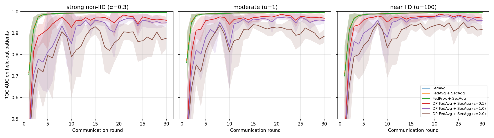
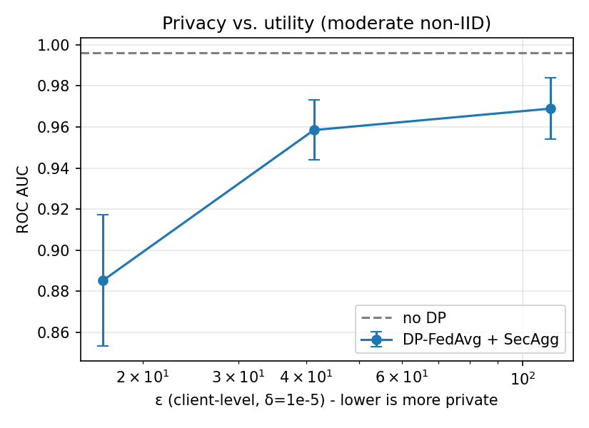

# fedhealth: privacy-preserving federated learning across simulated hospitals

A small, readable testbed for federated learning on medical data. Five simulated hospitals
train a shared diagnostic model **without their patient records ever leaving the hospital**.
The server only ever sees masked model updates, and can optionally add differential privacy.

Everything is implemented from first principles in PyTorch and NumPy, so each part can be read
and checked: no federated learning framework hides the details.

| Component | What it does | Where |
|---|---|---|
| FedAvg / FedProx | Weighted federated averaging; FedProx adds a proximal term for non-IID data | `fedhealth/federation.py` |
| Secure aggregation | X25519 key agreement + HKDF + pairwise masks (Bonawitz et al. 2017, simplified). The server learns only the sum. | `fedhealth/secure_agg.py` |
| Client-level differential privacy | Update clipping + Gaussian noise (DP-FedAvg) with a Rényi-DP accountant reporting (ε, δ) | `fedhealth/privacy.py` |
| Federated standardisation | Global feature means/variances computed through secure aggregation of local sums | `fedhealth/federation.py` |
| Non-IID partitioning | Dirichlet label skew to mimic hospitals with very different patient mixes | `fedhealth/data.py` |
| Data quality reports | Per-hospital checks (sample size, class balance, missing values, outliers, constant features) that produce shareable summaries only | `fedhealth/data.py` |
| Cost tracking | Bytes exchanged per round and wall-clock time | `fedhealth/federation.py` |

## Data

The [Wisconsin Diagnostic Breast Cancer](https://archive.ics.uci.edu/dataset/17/breast+cancer+wisconsin+diagnostic)
dataset (569 patients, 30 features from digitised biopsy images, benign vs. malignant), which ships
with scikit-learn, so no download is needed. 20% of patients are held out as an external test
cohort that no hospital trains on. The rest is split across five hospitals with a Dirichlet
label skew (α = 0.3, 1, 100).

## Results

5 hospitals, 30 rounds, 5 random seeds (mean ± std). Full tables: [`results/results.md`](results/results.md).

**Moderately non-IID hospitals (α = 1):**

| Method | Accuracy % | ROC AUC % | ε (δ = 1e-5) | Traffic |
|---|---|---|---|---|
| Centralised (all data pooled, not privacy-preserving) | 97.9 ± 0.9 | 99.6 ± 0.2 | - | - |
| Each hospital alone | 86.0 ± 6.3 | 91.2 ± 8.3 | - | - |
| FedAvg | 97.2 ± 0.7 | 99.6 ± 0.2 | no DP | 2.5 MB |
| FedAvg + secure aggregation | 97.2 ± 0.7 | 99.6 ± 0.2 | no DP | 3.8 MB |
| DP-FedAvg + SecAgg, z = 0.5 | 90.9 ± 3.3 | 96.9 ± 1.5 | 112.6 | 3.8 MB |
| DP-FedAvg + SecAgg, z = 1.0 | 88.4 ± 4.5 | 95.8 ± 1.5 | 41.3 | 3.8 MB |
| DP-FedAvg + SecAgg, z = 2.0 | 86.3 ± 4.7 | 88.5 ± 3.2 | 16.9 | 3.8 MB |





**What the numbers say**

- **Federation recovers almost all of the value of pooling data.** With strongly skewed hospitals
  (α = 0.3) a hospital training alone reaches 71.6% accuracy on average, sometimes far worse, because
  some hospitals see almost only one class. FedAvg reaches 97.0%, within a point of the centralised model.
- **Secure aggregation is free in accuracy.** Results are identical to plain FedAvg (tested), at
  about 50% more upload traffic because masked values are 64-bit integers.
- **FedProx gives no gain here.** The model and data are small enough that FedAvg already converges well.
- **Client-level differential privacy is expensive with few clients.** Protecting whole hospitals
  with only five participants needs a lot of noise per participant. Even the noisiest setting tested
  (ε ≈ 17) costs about 11 AUC points, and ε values this large give only weak formal guarantees.
  Realistic deployments need more clients, client subsampling (privacy amplification), fewer rounds,
  or record-level DP-SGD inside each hospital. This is the main practical lesson of the project.
- **The quality reports catch the problems that explain the gaps.** Under strong skew, several
  hospitals have only one class or fewer than 50 samples, and are flagged before training starts.

## Threat model and limitations (please read)

- The server is assumed **honest-but-curious**. Public keys are relayed without authentication,
  so an active man-in-the-middle is not covered. A real deployment would authenticate keys with
  certificates (mutual TLS / a PKI).
- Secure aggregation has **no dropout recovery**. The full protocol secret-shares the mask seeds
  (Shamir) so the sum can still be recovered if a client disconnects; that is not implemented.
- In DP mode the **server adds the noise** after the secure sum. If the server should not be trusted
  with this, the noise would need to be generated in a distributed way by the clients.
- Privacy accounting assumes every client takes part in every round (no subsampling), which is conservative.
- This is a **simulation in one process**. There is no network transport, no homomorphic encryption,
  and the dataset is small and tabular. It demonstrates the algorithms and their trade-offs, not a
  production system.

## Run it

```bash
pip install -r requirements.txt
pytest -q                   # 12 tests: secure sums are exact, masks hide inputs, training converges
python benchmark.py         # about 5 minutes on a laptop CPU; writes results/
python benchmark.py --seeds 2 --rounds 20   # quicker
```

## References

- McMahan et al. (2017). Communication-Efficient Learning of Deep Networks from Decentralized Data. AISTATS.
- Li et al. (2020). Federated Optimization in Heterogeneous Networks (FedProx). MLSys.
- Bonawitz et al. (2017). Practical Secure Aggregation for Privacy-Preserving Machine Learning. ACM CCS.
- McMahan et al. (2018). Learning Differentially Private Recurrent Language Models. ICLR.
- Mironov (2017). Rényi Differential Privacy. IEEE CSF.
- Hsu et al. (2019). Measuring the Effects of Non-Identical Data Distribution for Federated Visual Classification.
